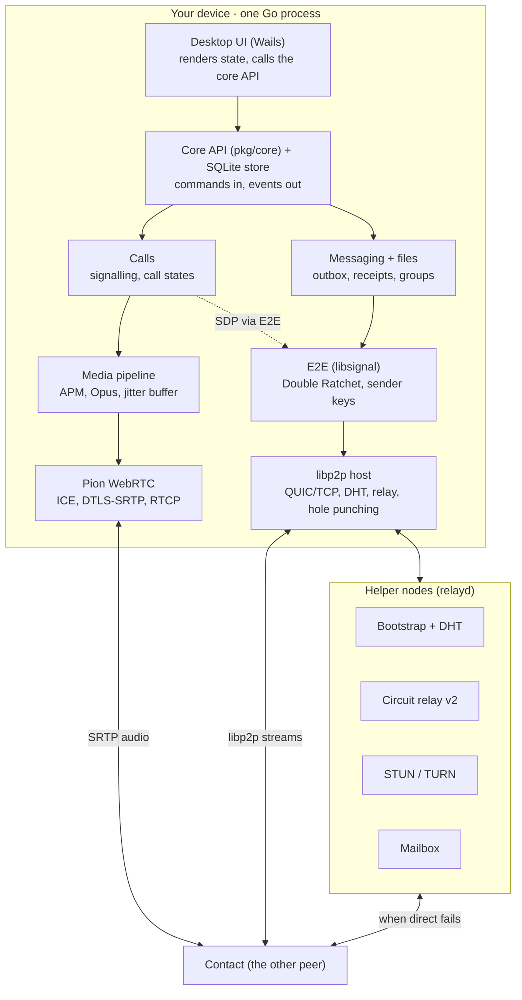
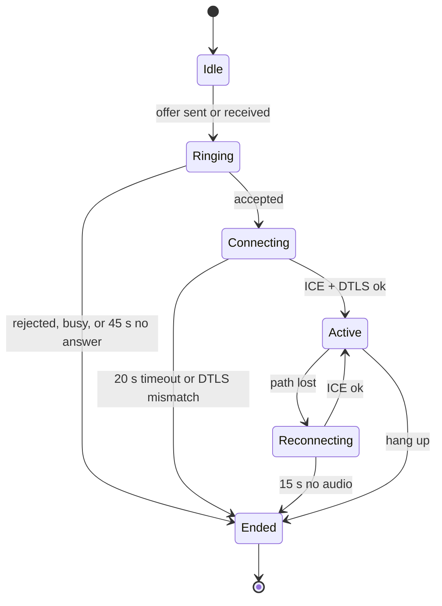

# P2P Messaging + Voice in Go — Build Plan

Oct 23, 2026

## Scope and assumptions

Build a desktop-first app where people exchange end-to-end encrypted messages and make voice calls, with no server that stores or reads content. A few small helper nodes you run handle discovery and network fallback.

**What v1 does**

- 1:1 and small-group text chat (up to \~20 members) with delivery and read receipts
- 1:1 voice calls; group voice for up to 4 people is a stretch goal
- File and image attachments
- Contacts added by QR code or invite link — no phone number, email or account server

**What "P2P" means here.** Message and voice content travel directly between peers whenever the network allows. You still run helper nodes (bootstrap peers, relays, a TURN server, an optional mailbox), but they only see ciphertext and routing metadata. A strictly serverless app fails for users behind carrier-grade or symmetric NAT and cannot deliver to someone who is offline.

**Assumptions** (change one and parts of this plan change)

- Desktop first: Linux, macOS, Windows. The core is a Go library, so a mobile client can bind to it later.
- A team of 1–2 developers; the roadmap is sized for that.
- cgo is acceptable — audio capture and echo cancellation need native code.

**Non-goals for v1:** video, large groups or channels, interop with other messengers, anonymity against network observers, multi-device sync.

## Architecture overview

Each device runs one Go process with two network planes under a shared core: libp2p carries contacts, messages and call signalling; Pion WebRTC carries live audio. The helper nodes you run only assist discovery and fallback.



Read it top-down: the UI talks only to the core, each service owns its own state, and everything is encrypted before it reaches libp2p or Pion.

## Tech stack

The core decision: **go-libp2p for the messaging plane, Pion WebRTC for the voice plane.** libp2p gives you identity, discovery, encrypted streams and NAT traversal; Pion gives you a real-time media stack (RTP, jitter handling, congestion control) that a reliable stream cannot. Call setup is signalled over libp2p, so both planes share one identity.

| Concern | Pick | Why | Fallback |
| --- | --- | --- | --- |
| Toolchain | Go 1.26 | [go-libp2p v0.50](https://tproger.ru/news/go-libp2p-0-50-0-perewyol-na-go-1-26-i-obnovil-quic-go-i-webtrans) (Sep 2026) requires it | — |
| P2P networking | go-libp2p | QUIC and TCP transports, Noise/TLS, peer IDs, hole punching, relay v2, AutoNAT built in | quic-go plus your own discovery: months more work |
| Discovery | go-libp2p-kad-dht + mDNS | Find any peer by ID over the internet; find LAN peers with no internet | A rendezvous server |
| Voice transport | [Pion WebRTC v4](https://github.com/pion/webrtc/wiki/Release-WebRTC@v4.2.0) | Pure Go ICE/STUN/TURN, DTLS-SRTP, RTCP | RTP over libp2p streams: head-of-line blocking on loss |
| RTP helpers | [pion/interceptor](https://pkg.go.dev/github.com/pion/interceptor/pkg/jitterbuffer) | Jitter buffer, NACK, stats, Google Congestion Control | Your own jitter buffer |
| TURN server | pion/turn inside your relay daemon | Last-resort media relay | coturn |
| Audio I/O | malgo (miniaudio, cgo) | One API over WASAPI, CoreAudio, ALSA, PulseAudio | PortAudio bindings |
| Echo cancel, noise, gain | WebRTC APM via cgo ([CoyAce/apm](https://pkg.go.dev/github.com/CoyAce/apm) or [LiveKit's apm](https://pkg.go.dev/github.com/livekit/livekit-cli/v2@v2.17.0/pkg/apm)) | AEC3, noise suppression, AGC from the WebRTC engine | speexdsp via cgo (weaker AEC) |
| Opus codec | libopus via cgo (hraban/opus) | Reference encoder with FEC, DTX and loss concealment | [gopus](https://pkg.go.dev/github.com/thesyncim/gopus), pure Go — evaluate in Phase 3 |
| 1:1 encryption | [go.mau.fi/libsignal](https://godocs.io/go.mau.fi/libsignal) | Go port of the Signal protocol: X3DH, Double Ratchet, sender keys, fingerprints | Never hand-roll a ratchet |
| Group encryption | Sender Keys (same library) | Simple, fine up to \~20 members | MLS later ([go-mls](https://pkg.go.dev/git.sr.ht/~emersion/go-mls) is early) |
| Wire format | Protocol Buffers, varint length-prefixed | Compact, versionable schemas | CBOR |
| Storage | SQLite via modernc.org/sqlite | Pure Go, one file, transactional | mattn/go-sqlite3 or SQLCipher (cgo) |
| Secrets | OS keychain (zalando/go-keyring) | Holds the identity key and DB key | Passphrase + Argon2id |
| Desktop UI | Wails (Go + web frontend) | Fastest route to a polished chat UI | Fyne or Gio (pure Go, also run on mobile) |
| Mobile, later | gomobile bind of the core package | Same core on Android and iOS | — |

**On cgo:** audio I/O, echo cancellation and libopus all need it. Accept it from day one and set up cross-compilation in CI early (Zig as the C toolchain works well), rather than discovering it in Phase 3.

## Identity, contacts and discovery

Each install generates an Ed25519 key pair; its hash is the libp2p peer ID and the user's address. Contacts are exchanged out of band, and the DHT turns a peer ID into current network addresses.

**Identity**

- The Ed25519 identity key is created on first launch and kept in the OS keychain. Peer ID = multihash of its public key.
- The Signal identity key (Curve25519) is separate; sign it with the Ed25519 key so the two are provably bound.
- Display name and avatar are self-asserted and not unique — the peer ID is the real identity.
- Losing the key means losing the identity. Offer an encrypted backup protected by a recovery phrase from Phase 2.

**Contact card** — what a QR code or invite link carries, as a base32-encoded protobuf:

- Peer ID and Signal identity key with its signature
- A signed prekey bundle, so the first message can be encrypted before both sides are online
- Display name, a few last-known addresses as hints, chosen mailbox (Phase 5), protocol version

**Adding a contact.** Scanning a card sends a contact request; nothing else is accepted from a peer until the request is approved. Messages from unknown peers go to a request inbox or are dropped. This is your main anti-spam control.

**Verification.** Show a safety number (libsignal's fingerprint package) that two people compare in person or by scanning each other's QR. Mark the contact verified, and warn loudly if their identity key ever changes.

**Finding a contact's current address**, in order:

1. Last-known addresses from the local cache
2. mDNS on the local network
3. DHT peer lookup by peer ID
4. Relay addresses — peers behind NAT advertise a `/p2p-circuit` address through their relay reservation

**Private DHT, not the public IPFS one.** Run your own Kademlia DHT with an app-specific protocol prefix, bootstrapped from your own nodes. The public IPFS DHT is larger, but it is crawled by public monitors, so your users' peer IDs and IPs would be indexed. Desktop clients run in auto mode; clients behind NAT and future mobile clients run in client mode.

## Networking and NAT traversal

Plan for about 3 in 10 connections to need a relay permanently. A [large measurement of libp2p hole punching](https://arxiv.org/html/2510.27500v1) found a 70% ± 7.1% success rate across 85,000+ networks, roughly the same over TCP and QUIC. Relays are part of the product, not an edge case.

**Transports.** QUIC (UDP) first, TCP as fallback, both on. Noise or TLS 1.3 secures every connection and authenticates the peer ID. WebTransport or WebRTC-direct can be added later if you ever want a browser client.

**libp2p host options to turn on:** UPnP/NAT-PMP port mapping (`NATPortMap`), hole punching (`EnableHolePunching`), auto-relay pinned to your own relays (`EnableAutoRelayWithStaticRelays`), AutoNAT for reachability detection, plus the resource manager and connection manager with explicit limits.

**Connection ladder for messaging**, tried per contact:

1. Direct dial — LAN address, public IP, or a UPnP-mapped port
2. Relayed connection through one of your circuit relays
3. DCUtR upgrade — libp2p coordinates a simultaneous hole punch over the relayed connection and switches to direct if it works
4. If the punch fails, stay on the relay

**Relay limits matter.** go-libp2p's relay v2 defaults [reset a relayed connection after 2 minutes or 128 KB per direction](https://godocs.io/github.com/libp2p/go-libp2p/p2p/protocol/circuitv2/relay) — enough to coordinate a hole punch, not to carry a chat. Your relays set their own per-circuit limits sized for messaging (tens of minutes, a few MB), with per-peer and per-IP caps so they don't become a free proxy.

**Voice takes its own path.** Pion's ICE gathers host, STUN (server-reflexive) and TURN candidates and picks the best working pair. Run STUN and TURN on the same boxes as your libp2p relays. Issue short-lived TURN credentials over a small libp2p protocol on the relay, rate-limited per peer ID — there is no login server to issue them otherwise.

**Keeping connections alive.** Send libp2p pings often enough to hold UDP NAT mappings open while a conversation or call is active (every 15–25 s), and back off when idle. On a network change (Wi-Fi to Ethernet, VPN on), re-reserve relay slots, re-advertise addresses and trigger an ICE restart for any active call.

## Messaging protocol

Every message is a protobuf envelope, encrypted with the Signal session, sent over a dedicated libp2p stream protocol and retried from a persistent outbox until the recipient acknowledges it. Delivery is at-least-once; deduplication by message ID makes it exactly-once for the user.

**Stream protocols**

| Protocol ID | Carries |
| --- | --- |
| `/p2pchat/contact/1.0.0` | Contact requests, prekey bundle refresh |
| `/p2pchat/msg/1.0.0` | Message envelopes and acknowledgements |
| `/p2pchat/sync/1.0.0` | Catch-up after reconnect |
| `/p2pchat/call/1.0.0` | Voice call signalling |
| `/p2pchat/file/1.0.0` | Attachment chunks |

Frames are varint length-prefixed protobufs; cap an envelope at 64 KB and send anything larger as an attachment. Version every protocol ID and negotiate down rather than breaking old clients.

**Envelope and content**

```proto
message Envelope {          // outer: visible to relays and mailboxes
  uint32 version = 1;
  bytes  recipient = 2;     // peer ID
  bytes  envelope_id = 3;
  uint32 cipher_type = 4;   // Signal prekey or regular message
  bytes  ciphertext = 5;    // encrypted Content
}

message Content {           // inner: only the recipient can read
  bytes  message_id = 1;    // UUIDv7, time-sortable
  bytes  conversation_id = 2;
  uint64 hlc = 3;           // hybrid logical clock
  oneof body {
    Text text = 10;  Receipt receipt = 11;  Reaction reaction = 12;
    Edit edit = 13;  Delete delete = 14;    Typing typing = 15;
    Attachment attachment = 16;  GroupControl group = 17;  CallEvent call = 18;
  }
}
```

**Delivery.** A sent message goes into the outbox table and stays there until a delivery receipt arrives. When libp2p reports a new connection to a contact, flush that contact's outbox with backoff. Read receipts and typing indicators are optional per user.

**Ordering.** Wall clocks lie. Stamp each message with a hybrid logical clock and sort by (HLC, sender peer ID), so both sides show the same order.

**Offline delivery**, in three levels:

1. Both online — delivered directly.
2. Recipient offline — the sender's outbox holds it until both are online again. This is the v1 baseline.
3. Mailbox (Phase 5) — an always-on node stores ciphertext envelopes for a recipient for up to 14 days. The recipient names its mailbox in its contact card and collects by signing a challenge. It can be a node you host, a friend's node, or the user's own always-on machine.

**Sync after reconnect.** Peers exchange, per conversation, the highest HLC each has received from the other, then resend anything missing from their outboxes. With 1:1 history living on exactly two devices, this stays simple.

**Groups (up to \~20).** A group is an ID, a member list and admins. Membership changes are signed control messages sent pairwise. Content uses Sender Keys: each member hands its sender key to every other member over 1:1 sessions, then encrypts each message once and sends the same ciphertext to each member. Rotate everyone's sender keys when someone leaves. Larger groups later move to GossipSub topics and MLS.

**Attachments.** Encrypt the file with a fresh AES-256-GCM key in fixed-size chunks and hash it. The message carries the key, hash and size; the recipient pulls chunks over the file protocol, from the sender or a mailbox, and resumes by chunk index.

## End-to-end encryption and security model

Two independent layers: libp2p's Noise/TLS encrypts and authenticates every hop, and Signal protocol sessions encrypt each message end to end, so relays, mailboxes and TURN servers only ever see ciphertext.

| Layer | Protects | Mechanism |
| --- | --- | --- |
| Transport | Each connection, including the hop to a relay | Noise XX or TLS 1.3, authenticated by peer ID |
| Messages | Content against relays, mailboxes and later key theft | X3DH key agreement + Double Ratchet (forward secrecy, post-compromise recovery) |
| Groups | Group content | Sender Keys, rotated on every membership change |
| Voice | Audio | DTLS-SRTP, with the DTLS fingerprint bound to the contact's identity |
| At rest | The local database | Key in the OS keychain; message bodies encrypted in the DB |

**Session setup.** The first message uses the prekey bundle from the contact card, or a fresh one fetched over the contact protocol or from the recipient's mailbox. Rotate the signed prekey on a schedule and keep a stock of one-time prekeys topped up.

**Binding voice to identity.** The SDP offer and answer carry each side's DTLS certificate fingerprint. Because SDP travels inside a Signal-encrypted message over an authenticated libp2p stream, the fingerprint is authenticated too. After the DTLS handshake, check that the remote certificate matches; if not, drop the call. This closes the man-in-the-middle gap that plain WebRTC signalling leaves open.

**What this protects against:** network observers, relay, mailbox and TURN operators, and a seized or compromised relay.

**What it does not protect against:** a compromised device, and metadata. Peers on a direct connection see each other's IP address; relays and the DHT see who is online and who connects to whom. Say so in the app, and offer a relay-only mode that hides IPs from contacts at the cost of latency.

**Security engineering checklist**

- [ ] Fuzz every protobuf decoder and state machine with `go test -fuzz`
- [ ] Accept nothing but contact requests from unknown peers; rate-limit those per peer and per IP
- [ ] Persist the ratchet advance and the decrypted message in one database transaction
- [ ] Never log plaintext or keys; scrub crash reports
- [ ] Safety numbers and loud key-change warnings in the UI
- [ ] External security audit of the crypto and protocol layers before public launch

## Voice calls

A call is a Pion WebRTC peer connection carrying one Opus audio track. Its offer and answer travel as Signal-encrypted messages over libp2p, so call setup reuses contact identity and works through the same relays as chat.

**Signalling messages** (call protocol, inside the end-to-end layer)

| Message | Sent by | Carries |
| --- | --- | --- |
| CallOffer | Caller | Call ID, SDP offer with DTLS fingerprint |
| Ringing | Callee | Call ID |
| CallAnswer | Callee | Call ID, SDP answer |
| IceCandidate | Both | Trickled ICE candidates |
| Reject / Busy / Hangup | Either | Call ID, reason |
| Renegotiate | Either | ICE-restart offer after a network change |



Starting timeouts shown; tune them during Phase 3. Hang-up or cancel in any state also goes straight to Ended.

One state machine runs on both sides; caller and callee both pass through Ringing. Implement it as a single goroutine per call that owns the state and the Pion peer connection, and unit-test every transition.

**Send pipeline**

1. Capture 48 kHz mono in 10 ms frames (malgo).
2. Run WebRTC APM: echo cancellation (fed with what the speaker is playing), noise suppression, gain control, high-pass filter.
3. Encode Opus in 20 ms frames, VoIP mode, 24–32 kbps VBR, in-band FEC and DTX on.
4. Write samples to a Pion local track; Pion packetises to RTP, encrypts with SRTP and sends over the chosen ICE path.

**Receive pipeline**

1. Read RTP from the remote track into an adaptive jitter buffer (pion/interceptor's, or your own).
2. Decode Opus. For a missing packet, recover it from the next packet's FEC, else use Opus loss concealment.
3. Mix (needed later for group calls), feed the result to the echo canceller as the reference signal, and play it out (malgo).

**Quality targets and adaptation**

- Mouth-to-ear latency under 150 ms on a direct path; measure it with a loopback rig in Phase 3.
- Read loss and RTT from RTCP reports (Pion's stats interceptor). Under loss, raise Opus's expected-loss setting and lower the bitrate; follow the congestion controller's bandwidth estimate.
- Capture and playback clocks drift apart over a long call. The jitter buffer must absorb drift by occasionally inserting or dropping a few samples.
- Handle device hot-plug and Bluetooth headsets switching sample rate; resample everything to 48 kHz at the device edge.

**Group voice (stretch).** A full mesh works up to about 4 people: each sends its track to every other peer, three Opus uplinks at \~32 kbps. Beyond that you need a media server (SFU), which breaks the P2P model, so keep group voice small.

## Local storage and data model

One SQLite file per profile holds everything except private keys, which live in the OS keychain. The device is the only copy of history, so storage must be crash-safe.

| Table | Holds |
| --- | --- |
| contacts | Peer ID, name, Signal identity key, verified flag, blocked flag, last-known addresses, mailbox |
| sessions, prekeys, sender\_keys | libsignal state, behind its store interfaces |
| conversations | ID, direct or group, members, settings such as disappearing-message timer |
| messages | UUIDv7 ID, conversation, sender, HLC, kind, encrypted body, status — indexed on (conversation, HLC) |
| outbox | Envelope bytes, recipient, attempt count, next retry — deleted on receipt |
| attachments | Hash, key, size, local path, chunks received |
| calls | Call ID, peer, direction, start, duration, outcome |

**Rules that prevent data loss**

- Decrypting a message advances the ratchet. Save the new ratchet state and the message in the same transaction, or a crash between the two loses the message for good.
- Use WAL mode and run migrations from embedded SQL files on startup.
- Message bodies are encrypted with a key from the keychain. A full-text search index would hold plaintext, so make search opt-in or rely on full-disk encryption.
- Export and import an encrypted backup archive (keys + database) from Phase 2.

## Client, UI and repository layout

Keep all logic in a Go core with a small API and an event stream; the UI only renders state and calls the API. That keeps the UI swappable and lets a headless CLI client drive integration tests.

**Core API shape:** `Start`, `Stop`, `AddContact`, `AcceptContact`, `Send`, `MarkRead`, `StartCall`, `AnswerCall`, `Hangup`, `SetMute`, plus a `Subscribe` event stream (message received, receipt, contact online, incoming call, call state, connection quality). Keep its types simple enough for gomobile to bind.

**UI toolkit**

| Option | Good at | Weak at |
| --- | --- | --- |
| Wails (recommended for desktop) | Polished chat UI with web tech, native webview, small binaries | A second language (TypeScript) in the stack |
| Fyne | Pure Go, one codebase for desktop and mobile | Less native look; complex lists take effort |
| Gio | Pure Go, fast, desktop and mobile | Immediate-mode API has a learning curve |

Pick Wails if desktop is the focus and native mobile UIs come later. Pick Fyne or Gio if one Go codebase across desktop and mobile matters more than polish.

**Repository layout**

```
p2pchat/
├── cmd/
│   ├── p2pchat/        desktop app (Wails)
│   ├── p2pchat-cli/    headless client for development and scripted tests
│   └── relayd/         bootstrap + relay + AutoNAT + STUN/TURN + mailbox
├── pkg/core/           public facade: Node, API, events (gomobile-safe)
├── internal/
│   ├── identity/       keys, contact cards, safety numbers
│   ├── p2p/            libp2p host, DHT, mDNS, relay client, connection policy
│   ├── proto/          .proto files and generated code
│   ├── e2e/            libsignal wrapper and SQLite-backed stores
│   ├── messaging/      envelopes, outbox, receipts, sync, groups
│   ├── files/          attachment chunking and transfer
│   ├── call/           signalling, call state machine, Pion peer connection
│   ├── media/          audio I/O, APM, Opus, jitter buffer, mixer
│   ├── mailbox/        client and server sides
│   └── store/          SQLite, migrations
├── frontend/           Wails web UI
├── deploy/             relayd container, systemd units, infra config
└── test/               integration tests, NAT lab, audio fixtures
```

**Concurrency model.** One goroutine reads each stream; each service (messaging, calls, files) owns its state and receives work over channels; every operation takes a `context.Context` for cancellation. Audio runs on its own goroutines with preallocated buffers — never block the capture or playback callbacks on locks or the database.

## Roadmap

Roughly seven months to a public beta. Each phase ends with something that runs: networking first, then security, then voice, then polish. A second developer can build the desktop UI (Phase 4) alongside voice (Phase 3).

| Phase | Weeks | Delivers | Exit gate |
| --- | --- | --- | --- |
| 0 · Spikes | 0–2 | libp2p message between two machines on different home networks; Pion audio loopback; cgo CI on 3 OSes | A message crosses two NATs; audio round-trips on Linux, macOS and Windows |
| 1 · Text chat (CLI) | 2–6 | Identity, contact cards, private DHT, relay fallback, protobuf protocol, SQLite, outbox | Messages arrive across NATs, via relay when needed, and survive restarts |
| 2 · E2E + reliability | 6–10 | libsignal sessions, safety numbers, receipts, sync, encrypted backup, fuzzing | No plaintext on the wire or at relays; a `kill -9` test loses nothing |
| 3 · 1:1 voice | 10–16 | Call signalling and state machine, Pion, Opus, APM, jitter buffer, TURN | 30-minute call; under 150 ms mouth-to-ear on a direct path; no echo on laptop speakers; usable at 5% loss |
| 4 · Desktop UI | 16–20 | Wails app, notifications, installers, auto-update, diagnostics screen | A non-technical tester installs, adds a contact, chats and calls unaided |
| 5 · Groups, files, mailbox | 20–25 | Sender Keys groups up to 20, attachments with resume, mailbox role in relayd | A 20-member group works; a 100 MB file resumes; messages reach an offline contact |
| 6 · Hardening + beta | 25–29 | External audit, NAT lab matrix, metrics, crash reporting, closed beta | Audit findings fixed; 95%+ of beta conversations connect, direct or relayed |

Mobile (the same core via gomobile, plus content-free push wake-ups) follows the beta as its own project.

## Testing, observability and helper infrastructure

The two things that break P2P apps in the field are network paths and audio, so both get dedicated test rigs from the phase that introduces them.

**Testing**

| Layer | How |
| --- | --- |
| Codecs, state machines, crypto wrapper | Unit tests + `go test -fuzz` on every decoder |
| Multi-peer logic | libp2p's in-memory mock network: many hosts in one test process |
| NAT traversal | Docker + network namespaces + iptables to emulate cone NAT, symmetric NAT and blocked UDP; run the full connection ladder in each combination |
| Call quality | `tc netem` for loss, jitter and delay; record both ends and score with ViSQOL or PESQ; track Pion stats |
| Echo cancellation | Real laptops on built-in speakers, not just headsets |
| Durability | `kill -9` mid-conversation, then check nothing is lost or duplicated; 24-hour soak between two nodes |
| Platforms | CI matrix on Linux, macOS and Windows with the race detector — cgo makes each platform different |

**Observability without surveillance**

- In the app: a diagnostics screen showing reachability (AutoNAT), whether each contact is direct or relayed, and live call stats (RTT, loss, jitter, bitrate).
- Opt-in anonymous metrics only: connection success by path type, call setup time, call drop rate. Never peer IDs or content.
- On your infrastructure: Prometheus metrics from go-libp2p (resource manager, relay service), TURN bandwidth, mailbox queue depth, with alerts.

**The relay daemon (`relayd`)** is one Go binary with switchable roles:

- DHT bootstrap node in server mode
- Circuit relay v2 with your own limits and per-peer/per-IP caps
- AutoNAT server
- STUN/TURN (pion/turn) with short-lived credentials
- Mailbox (Phase 5)

Start with 3 small VPSs in different regions. Persist each node's key so its peer ID never changes, and ship the bootstrap list to clients as DNS names, so you can move servers without a client release. TURN bandwidth is the main running cost: a relayed 32 kbps Opus call moves roughly 15–20 MB per direction per hour including packet overhead.

## Risks and open decisions

The biggest risks are not code but environment: networks that block direct paths, mobile operating systems that suspend background sockets, and audio hardware that echoes.

| Risk | Impact | Mitigation |
| --- | --- | --- |
| \~30% of hole punches fail | Slow or failed delivery without relays | Relays with raised limits, TURN for voice; measure the path mix in beta |
| Mobile background limits | No incoming messages or calls while the app sleeps | A push service that sends content-free wake-ups (APNs/FCM) — plan it with the mobile phase |
| Echo and audio quality | Bad calls lose users fast | WebRTC APM from day one; test on built-in speakers |
| cgo cross-compilation | Slow, fragile releases | CI matrix and cross toolchain set up in Phase 0 |
| Metadata exposure | Peers see IPs; relays and the DHT see who is online | Private DHT, relay-only mode, clear wording in the app |
| Key loss | Identity and history gone | Encrypted backup with a recovery phrase |
| Multi-device expectations | Users want phone + desktop | Out of scope for v1; keep IDs per-device so a device list can be added later |
| Spam | Anyone with a peer ID can knock | Contact-request gate, rate limits, block list |
| Relay abuse | Your relays become a free proxy | Per-peer, per-IP and per-protocol limits |

**Open decisions** (default in bold)

1. DHT: **private, app-specific** vs the public IPFS DHT
2. Group encryption: **Sender Keys** vs MLS
3. UI: **Wails** vs Fyne/Gio — depends on how soon mobile matters
4. Mailbox: **hosted by you, ciphertext only** vs user-run only

## Sources

- [go-libp2p 0.50.0 release and Go 1.26 requirement](https://tproger.ru/news/go-libp2p-0-50-0-perewyol-na-go-1-26-i-obnovil-quic-go-i-webtrans)
- [Large-scale measurement of DCUtR hole punching (arXiv 2510.27500)](https://arxiv.org/html/2510.27500v1)
- [ProbeLab: Can libp2p punch through NATs?](https://probelab.io/blog/can-libp2p-punch-through-nats/)
- [go-libp2p circuit relay v2 resource limits](https://godocs.io/github.com/libp2p/go-libp2p/p2p/protocol/circuitv2/relay)
- [Pion WebRTC v4.2.0 release](https://github.com/pion/webrtc/wiki/Release-WebRTC@v4.2.0)
- [pion/interceptor jitter buffer](https://pkg.go.dev/github.com/pion/interceptor/pkg/jitterbuffer)
- [go.mau.fi/libsignal](https://godocs.io/go.mau.fi/libsignal)
- [go-mls (RFC 9420)](https://pkg.go.dev/git.sr.ht/~emersion/go-mls)
- [WebRTC APM Go bindings (CoyAce/apm)](https://pkg.go.dev/github.com/CoyAce/apm)
- [LiveKit apm package](https://pkg.go.dev/github.com/livekit/livekit-cli/v2@v2.17.0/pkg/apm)
- [gopus, pure Go Opus](https://pkg.go.dev/github.com/thesyncim/gopus)
